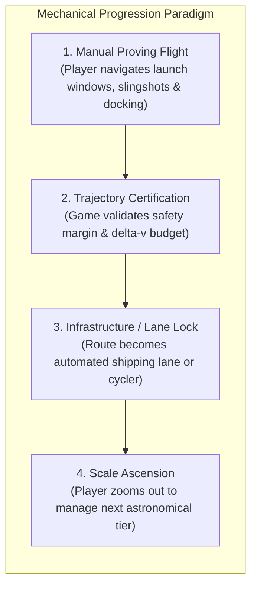

# Orbital Puzzle - Game Design & Technical Specification

## 1. Concept Overview
**Orbital Puzzle** is a top-down 2D puzzle simulation game grounded in orbital mechanics. Players launch spacecraft from rotating celestial bodies, leverage gravitational flybys (slingshots), and execute timed burns to rendezvous with orbiting or stationary stations across distinct tiers of astronomical scale.

The game is structured with a clear **2-Tier Astronomical Architecture**:
1. **Tier 3 (Planetary & Moon Subsystems):** Focused framing where a Gas Giant or Terrestrial Planet is the central massive anchor and moons/stations orbit cleanly without solar clutter.
2. **Tier 2 (Interplanetary Solar Scale):** Grand solar system framing where a central star is orbited by primary planets.
*(Designed to allow future extension to **Tier 1 Galactic Sector Scale** with binary stars and supermassive black holes).*

---

## 2. Core Gameplay Loop
1. **Analyze System:** Observe orbital radii, axial rotation directions, and target orbital tracks.
2. **Launch Window Timing (Scrubber):** Drag or micro-step the launch window scrubber ($T = 0$ to $90\text{s}$) with `[◀ / ▶]` single-step buttons or `[A / D]` keys to rotate the launch pad toward the ejection corridor.
3. **Booster Thrust Configuration:** Dial booster thrust ($10$ to $65\text{ m/s}$) with fine-step buttons `[▲ / ▼]` or arrow keys.
4. **Trajectory & Slingshots:** Trajectory projections feature **Chrono Time Pips** (`+5s`, `+10s`, `+15s`) and **Arrival Node Ghosts** (showing target position at closest approach with relative speed readouts).
5. **Rendezvous & SOI Capture:**
   - **Passive Clamp Capture:** Arriving within the target's Sphere of Influence ($R \approx 30\text{ AU}$) with relative velocity $v_{\text{rel}} \le v_{\text{limit}}$ automatically locks and docks.
   - **Target-Relative Braking:** Arriving within the target's SOI with $v_{\text{rel}} > v_{\text{limit}}$ enables continuous Target Braking (`HOLD [SPACE] OR [S]`), firing thrusters directly opposing the relative velocity vector until capture speed is attained.
6. **Resolution:**
   - **Success:** Target waypoint captured / docked.
   - **Failure:** Surface collision, fuel exhaustion, or deep-space escape.

---

## 3. Physics & Mechanics

### 3.1 Celestial System (Deterministic Rails)
* **Tier 3 Subsystems:** Central body is a planet (e.g., Terra, Zeus, Cronus); orbiting bodies are moons and stations.
* **Tier 2 Systems:** Central body is a star (Sol); orbiting bodies are primary planets.
* **Axial Rotation:** Bodies rotate on their axis at angular velocity $\omega_{\text{rot}}$. Surface launch pads rotate smoothly across time.
* **Faint Orbital Paths:** Faint dashed astronomical paths (`[4, 6]`, alpha 0.16) render for primary orbiting bodies.

### 3.2 Rocket Launch Velocity
When docked on a planet's surface of radius $R_{\text{body}}$ at angle $\theta(t) = \omega_{\text{rot}} \cdot t + \theta_0$:
$$\vec{v}_{\text{launch}} = \vec{v}_{\text{body\_orbit}} + \vec{v}_{\text{surface\_spin}} + \vec{v}_{\text{booster}}$$
* **Orbital Velocity ($\vec{v}_{\text{body\_orbit}}$):** Parent body's motion through space.
* **Surface Tangential Boost ($\vec{v}_{\text{surface\_spin}}$):**
  $$\vec{v}_{\text{surface\_spin}} = \omega_{\text{rot}} \cdot R_{\text{body}} \cdot \hat{t}$$
* **Booster Impulse ($\vec{v}_{\text{booster}}$):** Rocket booster normal to surface.

### 3.3 Gravitational Acceleration & Numerical Integration
* Gravitational acceleration in flight:
  $$\vec{a}(t) = \sum_{i} \frac{G \cdot M_i}{\left( |\vec{r}_i(t) - \vec{r}_{\text{rocket}}(t)|^2 + \epsilon^2 \right)^{3/2}} \left( \vec{r}_i(t) - \vec{r}_{\text{rocket}}(t) \right)$$
  Where $G = 1.0$ and softening parameter $\epsilon = 3.5$ prevents numerical singularities during close surface skimming.
* **Integrator:** Runge-Kutta 4th Order (`rk4Step`) at fixed 50Hz physics step (`dt = 0.02s`) for deterministic, drift-free orbital mechanics.

### 3.4 Predictive Trajectory & Rendezvous Visualization
* **Chrono Time Pips:** Rendered every 5 seconds along both the predicted flight path and the target's orbit, allowing players to visually compare flight timing against target travel.
* **Arrival Node Ghost:** Translucent hologram of the target rendered at the closest orbital approach point, featuring:
  - Target position at time $t_{\text{closest}}$.
  - Approach tether line connecting craft periapsis to target.
  - Telemetry badge indicating clamp capture status or required braking $\Delta v_{\text{rel}}$.
* **Encounter Ghosts:** Renders future planetary positions at close gravitational flyby points (`⚡ [BODY] FLYBY (T+XX.Xs)`).
* **Sub-Step Linear Interpolation:** Calculates exact waypoint capture timestamps without discrete stepping jitter.

### 3.5 Merged Capture & Target Braking
* Waypoint objects define `captureRadius` ($28\text{--}36\text{ AU}$) and `maxCaptureSpeed` ($16\text{--}24\text{ m/s}$).
* When inside the target's SOI, if $v_{\text{rel}} > v_{\text{limit}}$, thrusters automatically vector against $\vec{v}_{\text{rel}} = \vec{v}_{\text{craft}} - \vec{v}_{\text{target}}$.
* Holding `[SPACE]` or `[S]` burns RCS fuel to scrub relative velocity into capture range.

---

## 4. Campaign Level Structure & Solutions

### Chapter 1: Planetary & Moon Subsystems (Tier 3)
* **Level 1: Orbital Jump (Terra Subsystem)**
  * Anchor: Terra ($M = 12000$). Target: Station Alpha ($R = 110\text{ AU}$, $v = 0.095$).
  * Solution: $T = 6.5\text{s}$, Thrust $32\text{ m/s}$, Flight $3.7\text{s}$, Rel Speed $16.6\text{ m/s}$.
* **Level 2: The Moon Bridge (Terra & Luna Subsystem)**
  * Anchor: Terra ($M = 12000$) + Luna ($M = 2200$). Target: High Orbital Gate ($R = 240\text{ AU}$).
  * Solution: $T = 3.0\text{s}$, Thrust $32\text{ m/s}$, Flight $68.5\text{s}$, Rel Speed $17.5\text{ m/s}$.
* **Level 3: Jovian Resonance (Zeus & Io Subsystem)**
  * Anchor: Zeus ($M = 24000$) + Io ($M = 1600$, Launch Site). Target: Jovian Outpost ($R = 200\text{ AU}$).
  * Solution: $T = 16.0\text{s}$, Thrust $14\text{ m/s}$, Flight $6.6\text{s}$, Rel Speed $14.7\text{ m/s}$.
* **Level 4: Cronus Ring Run (Cronus & Titan Subsystem)**
  * Anchor: Cronus ($M = 20000$, Rings) + Titan ($M = 1800$, Launch Site). Target: Ring Station ($R = 110\text{ AU}$).
  * Solution: $T = 25.0\text{s}$, Thrust $24\text{ m/s}$, Flight $5.8\text{s}$, Rel Speed $11.1\text{ m/s}$.

### Chapter 2: Interplanetary Solar Systems (Tier 2)
* **Level 5: Inner Solar Leap (Sol & Astra)**
  * Anchor: Star Sol ($M = 38000$) + Astra ($M = 4600$). Target: Deep Space Beacon ($R = 340\text{ AU}$).
  * Solution: $T = 18.0\text{s}$, Thrust $26\text{ m/s}$, Flight $16.8\text{s}$, Rel Speed $15.0\text{ m/s}$.
* **Level 6: Martian Slingshot (Sol, Terra & Ares)**
  * Anchor: Sol ($M = 42000$) + Terra + Ares. Target: Asteroid Belt Spaceport ($R = 470\text{ AU}$).
  * Solution: $T = 52.0\text{s}$, Thrust $26\text{ m/s}$, Flight $14.7\text{s}$, Rel Speed $14.6\text{ m/s}$ (close flyby of Ares at $39.6\text{ AU}$, deep inside $122.4\text{ AU}$ SOI).
* **Level 7: Retrograde Vortex (Sol, Terra & Aphrodite Retrograde)**
  * Anchor: Sol ($M = 40000$) + Terra + Aphrodite ($\omega_{\text{rot}} = -0.15$). Target: Heliostation ($R = 155\text{ AU}$).
  * Solution: $T = 23.5\text{s}$, Thrust $22\text{ m/s}$, Flight $44.8\text{s}$, Rel Speed $9.6\text{ m/s}$.
* **Level 8: Jovian Catapult (Sol, Terra & Zeus)**
  * Anchor: Sol ($M = 44000$) + Terra + Zeus ($M = 25000$). Target: Kuiper Gate ($R = 680\text{ AU}$).
  * Solution: $T = 20.5\text{s}$, Thrust $24\text{ m/s}$, Flight $72.2\text{s}$, Rel Speed $13.9\text{ m/s}$.

### Chapter 3: Master Class Multi-Body Systems
* **Level 9: Triple Assist (Sol, Terra, Ares & Zeus)**
  * Anchor: Sol ($M = 46000$) + Terra + Ares + Zeus. Target: Frontier Array ($R = 600\text{ AU}$).
  * Solution: $T = 21.0\text{s}$, Thrust $30\text{ m/s}$, Flight $57.8\text{s}$, Rel Speed $14.3\text{ m/s}$ (chained flybys past Ares at $54\text{ AU}$ and Zeus at $156\text{ AU}$).
* **Level 10: Grand Jovian Tour (Sol-to-Zeus Insertion)**
  * Anchor: Sol ($M = 46000$) + Terra + Ares + Zeus. Target: Zeus Orbit Station ($R = 62\text{ AU}$ around Zeus).
  * Solution: $T = 20.0\text{s}$, Thrust $24\text{ m/s}$, Flight $32.2\text{s}$, Rel Speed $6.3\text{ m/s}$.

### Sandbox Mode (Level 0)
* Full 8-planet Solar System with gas giants and 8 orbiting moons.
* Right-click anywhere on the map to place custom waypoints.
* Verified Solution: $T = 2.2\text{s}$, Thrust $27\text{ m/s}$ ($12.8\text{s}$ flight to Europa at Jupiter, Rel Speed $17.7\text{ m/s}$).

---

## 5. UI & Technical Architecture

```
Orbital Puzzle/
├── index.html          # Web UI layout & modular script bootstrapping
├── style.css           # Glassmorphism cybernetic UI styling
├── serve.py            # Local Python dev server (supports target page argument)
├── README.md           # Documentation, quick start, verified solution table
├── SPEC.md             # This design & technical specification
├── galactic_demo.html   # Tier 1 Galactic Sector distribution prototype
├── continuum_demo.html  # Multi-Scale Cosmic Continuum prototype (Galactic -> Solar -> Moon)
└── src/
    ├── celestial.js     # CelestialBody class (orbits, rotation, gravity, rings)
    ├── game.js          # GameEngine loop, inputs, adaptive zoom, HUD sync
    ├── levels.js        # 10 verified campaign levels + Sandbox builder
    ├── physics.js       # RK4 integrator, ghost detection, time pips, sub-step interpolation
    ├── rocket.js        # Rocket state machine, continuous RCS, target braking physics
    ├── sound.js         # Procedural Web Audio API engine rumble & chord chimes
    ├── vector.js        # 2D Vector math library
    ├── waypoint.js      # Target waypoint class with SOI and relative velocity checks
    ├── galactic/        # Tier 1 Galactic Sector modules (distribution, renderer, sector generator)
    └── continuum/       # Cosmic Continuum modules (director, scenes, scale transitions)

---

## 6. Development & Autonomous Execution Protocol
* **Autonomous Server Launching:** Whenever writing, testing, or demonstrating code, prototypes, or side demos, the AI pair programmer **MUST always automatically launch the local development server** (`python serve.py [target]`) in the background. The user should never have to manually run terminal commands to start web servers.
* **Direct Clickable URLs:** Responses must always provide direct, clickable markdown links (e.g. `http://localhost:8000/continuum_demo.html`, `http://localhost:8000/galactic_demo.html`, or `http://localhost:8000/`) so the user can immediately jump into the live application with one click.

---

## 7. Cosmic Continuum Multi-Scale Architecture (Demo Mode)
* **Deterministic Sector & Orbits:** 65-star sector generated using Mulberry32 PRNG (seed `1042`) with analytical Keplerian orbits ($\theta(t) = \theta_0 + \omega t$).
* **Closed-Loop Proportional Navigation Guidance:**
  - **Stage 1 (Galactic):** Interstellar Guidance Controller (IGC) steers probe with lateral acceleration against Sagittarius Prime (SMBH mass 220,000) to reliably enter Sol Prime's SOI boundary ($R \le 135\text{ AU}$).
  - **Stage 2 (Solar):** Predictive Lead-Pursuit Mid-Course Correction (MCC) guides probe to Terra's future orbital position ($t_{\text{go}} = d_{\text{terra}} / v_{\text{probe}}$) with periapsis speed regulation ($v \le 24\text{ m/s}$) to guarantee Terra SOI entry ($R \le 65\text{ AU}$).
  - **Stage 3 (Planetary):** Terminal approach steering towards Station Alpha + target-relative RCS braking inside capture radius to achieve clamp docking lock ($v_{\text{rel}} \le 18\text{ m/s}$).
  - **Stage 4 (Terminal Docking & Celebration):** Live orbital rendering loop continues post-docking with pulsating clamp rings, debrief statistics modal, and restart capability.
* **Focal-Centered Cross-Fade Transitions:**
  - Preserves exact relative entry angle $\theta_{\text{entry}} = \text{atan2}(y_{\text{probe}} - y_{\text{body}}, x_{\text{probe}} - x_{\text{body}})$ and velocity heading $\theta_{\text{vel}} = \text{atan2}(v_y, v_x)$ across scale transitions.
  - Anchors destination celestial bodies (Sol Prime ➔ Sol at $(w/2, h/2)$; Terra ➔ Terra at $(w/2, h/2)$) in screen center during cross-fades, eliminating coordinate collisions and duplicate offset drawings.
* **Continuous Subsystem Clocks:**
  - Dedicated clocks (`this.solarTime` and `this.planetaryTime`) advance continuously during transitions, preventing celestial orbits from regressing backwards in time.

---

## 8. Automated Regression Test Suite
* Zero-configuration automated test suite managed via `pytest` (`pytest.ini`):
  1. `tests/test_vector.py`: Vector2 primitives, linear interpolation (`lerp`), and angle conversions.
  2. `tests/test_celestial_eval.py`: Analytical Keplerian orbit positions and hierarchical parent-child transforms.
  3. `tests/test_galactic_generation.py`: Mulberry32 PRNG reproducibility and 65-star sector structure.
  4. `tests/test_continuum_transitions.py`: Entry angle conservation, predictive MCC guidance, and docking math.
  5. `tests/test_continuum_e2e_cdp.py`: Headless Chrome DevTools Protocol (CDP) live end-to-end browser test verifying zero console exceptions, 3-tier traversal, and docking completion.
* **Execution:** `python -m pytest` executes all 14 tests in $\approx 17\text{s}$ with 100% pass rate.

---

## 9. Architectural Generalization Specification (Generic Engine vs Demo Configuration)

### 9.1 Architectural Assessment
The multi-scale architecture consists of a **mathematically generic engine core** driven by a **curated demo configuration**:

| Component | Architecture Status | Technical Details |
| :--- | :--- | :--- |
| **Coordinate Transformation** | **100% Generic Engine** | Patched-conics boundary calculation converts arbitrary 2D Cartesian positions and velocities into relative polar entry angles $\theta = \text{atan2}(\Delta y, \Delta x)$ and heading $\phi = \text{atan2}(v_y, v_x)$ for any target celestial body. |
| **Focal-Centered Viewport Cross-Fade** | **100% Generic Engine** | Anchoring $(w/2, h/2)$ on $(-\vec{r}_{\text{target}})$ in outgoing scene and $(0, 0)$ in incoming scene guarantees artifact-free transitions between any pair of astronomical bodies with zero coordinate collisions. |
| **Predictive Guidance (MCC)** | **100% Generic Engine** | Proportional lead-pursuit guidance dynamically predicts Keplerian orbital positions ($t + t_{\text{go}}$) on the fly. Verified across 16 arbitrary entry angles across $360^\circ$. |
| **Subsystem Clocks** | **100% Generic Engine** | Analytical orbits ($\theta(t) = \theta_0 + \omega t$) run on continuous dedicated clocks, eliminating temporal and positional discontinuities. |
| **Scene Graph Hierarchy** | *Demo Scaffolding* | Hardcoded to Sagittarius Prime ➔ Sol Prime ➔ Terra ➔ Station Alpha. Requires generalization to a dynamic tree structure. |
| **State Machine Direction** | *Demo Scaffolding* | 1-way inward progression (`T1 ➔ Trans1 ➔ T2 ➔ Trans2 ➔ T3 ➔ Dock`). Requires bidirectional (inward/outward) traversal. |

### 9.2 Production Generalization Blueprint (Hierarchical Scene Graph)
To transition from the automated demo into full interactive gameplay across all 65 systems:
1. **Hierarchical Tree Model:**
   ```
   Universe
   └── Sector (Galactic Scale - 65 Stars)
       └── Star System (Solar Scale - N Planets)
           └── Planetary Subsystem (Moon/Station Scale - M Satellites)
   ```
2. **Bidirectional Transition Protocol:**
   - **Inward Transition (SOI Capture):** When distance $d \le \text{body.soiRadius}$, capture relative state $(\theta_{\text{entry}}, \phi_{\text{vel}}, v_{\text{rel}})$, query body's child scene, and cross-fade downward one tier.
   - **Outward Transition (Hyperbolic Escape):** When distance $r > \text{scene.outerBoundary}$ and velocity is hyperbolic ($E > 0$), calculate state relative to parent anchor, and cross-fade upward one tier.

---

## 10. Performance, Scaling & Architecture Evolution

### 10.1 Computational Bottlenecks & Prototype Boundaries
While the HTML5/ES6 Canvas 2D prototype provides immediate developer velocity and frictionless web sharing, scaling the simulation across 65 systems and complex mechanics introduces hard performance walls:

1. **Garbage Collection (GC) Jitter:** In high-frequency integration loops, temporary math allocations (`Vector2` instances, trajectory step arrays) trigger V8 generational GC sweeps, causing 5–15ms frame drops that disrupt fluid 60/120 FPS rendering.
2. **Trajectory Optimization & Monte Carlo Sweeps:** Evaluating candidate launch corridors in real time (e.g., 500 candidate launch angles $\times$ 50 thrust levels = 25,000 RK4 trajectories) completely locks the single-threaded JavaScript main loop without complex `SharedArrayBuffer` / Web Worker choreography.
3. **Canvas 2D CPU Rasterization:** Rendering dense asteroid belts, relativistic accretion disks, pulsar radiation cones, and multi-craft flight paths saturates CPU rasterization, whereas modern GPU pipelines batch these via instanced vertex buffers and compute shaders.
4. **$N$-Body Gravitational Interactions:** Extending beyond fixed analytical Keplerian rails to true gravitational mutual perturbation scales at $O(N^2)$ per RK4 substep, demanding contiguous cache locality and auto-vectorized SIMD execution.

---

### 10.2 Language Evaluation Matrix

| Criterion | **Rust** *(Target Architecture)* | **C / C++** | **Python** | **JavaScript / TypeScript (Current)** |
| :--- | :--- | :--- | :--- | :--- |
| **Compute & SIMD Vectorization** | **Top Tier:** LLVM-optimized auto-vectorization (`f32x8`, `f64x4`), explicit packed structs, zero runtime abstraction cost. | **Top Tier:** Handcrafted AVX2/AVX-512 intrinsics, OpenMP, raw pointer efficiency. | **Unsuitable for Game Loops:** High interpreter overhead; fast only via NumPy/C extensions. | **Mid:** V8 JIT is fast, but lacks deterministic memory layout and raw SIMD intrinsics. |
| **Multithreading & Concurrency** | **Best-in-Class:** Compile-time data-race freedom. Mass parallel trajectory calculation via `rayon` (`par_iter()`) requires zero boilerplate. | **High Performance / High Vigilance:** `std::jthread`, OpenMP, job systems, but prone to data races and memory corruption. | **Restricted:** Global Interpreter Lock (GIL) blocks parallel CPU threads; requires process-based multiprocessing. | **Constrained:** Single-threaded event loop; Web Workers require serialized data transfer or complex atomics. |
| **Web Deployment (Zero-Install)** | **First-Class Citizen:** Compiles directly to `wasm32-unknown-unknown` with minimal binary footprint and near-native execution speed. | **Strong via Emscripten:** Robust, but tooling pipelines (`emcc`, CMake toolchains) are heavier and less modular. | **Impractical:** Pyodide / PyScript have massive runtime footprints ($15\text{MB}+$) and high initialization latency. | **Native:** Instant execution in any browser with zero compilation step. |
| **Memory & Frame Determinism** | **Zero GC:** Deterministic frame timing, zero allocation pauses, compile-time RAII ownership semantics. | **Zero GC:** Deterministic manual allocation, arenas, or custom pool allocators. | **High GC / Ref Counting:** Non-deterministic latency pauses. | **V8 GC Sweeps:** Generational GC pauses can disrupt frame rate during heavy math allocation. |
| **Ecosystem for Simulation & Games** | **Rapidly Maturing:** `bevy` (data-driven ECS), `wgpu` (cross-platform desktop & WebGPU), `macroquad`, `glam` (SIMD math). | **Battle-Tested:** Raylib, SDL2, Flecs ECS, bgfx, ImGui. | **Scientific Gold Standard:** Astropy, poliastro, SciPy (invaluable for offline verification). | Canvas 2D, PixiJS, Three.js, Babylon.js. |

---

### 10.3 In-Depth Evaluation of Rust for Orbital Mechanics

1. **Fearless Trajectory Exploration:**
   Parallelizing brute-force launch window sweeps across CPU cores is trivial and safe:
   ```rust
   let valid_windows: Vec<LaunchSolution> = candidates
       .par_iter()
       .filter_map(|cand| evaluate_rk4_trajectory(&sector, cand))
       .collect();
   ```
   Rust's borrow checker statically guarantees that the immutable planetary state cannot be corrupted across worker threads.

2. **Unified Native Desktop & WebGPU Pipeline:**
   Using `wgpu` or lightweight frameworks (`macroquad` / `bevy`), the identical Rust codebase compiles to:
   - Native binaries (`.exe`, Linux ELF, macOS Mach-O) utilizing Vulkan or DirectX 12.
   - WebAssembly (`wasm32-unknown-unknown`) utilizing WebGPU / WebGL2, preserving zero-install browser playability on GitHub Pages.

3. **Data-Oriented ECS & Cache Locality:**
   Entities (stars, planets, moons, stations, probes, debris) stored in Structure-of-Arrays (SoA) format allow sequential SIMD cache-line reads during gravitational field calculations, eliminating pointer chasing.

4. **Dimensional & Typestate Safety:**
   - Zero-cost wrapper types (`struct AU(f64)`, `struct DeltaV(f64)`) prevent unit conversion bugs at compile time.
   - Typestate patterns enforce valid craft states (e.g. `Probe<Docked>` cannot trigger RCS burns until transitioning to `Probe<InFlight>`).

---

### 10.4 Strategic Migration Roadmap

* **Phase 1: Rapid Prototype & Game Design (Current - JS/HTML5):**
  - Finalize multi-scale continuum navigation, hierarchical scene tree, and puzzle level progression.
  - Maintain instant iteration loop without compile times.
* **Phase 2: Hybrid Acceleration (Rust Wasm Core):**
  - Implement a dedicated Rust crate for the RK4 integrator, trajectory predictor, and collision detection.
  - Compile to WebAssembly via `wasm-bindgen` and expose a flat Float64Array buffer interface to the JS UI.
  - Achieves $5\times\text{--}10\times$ faster trajectory forecasting with zero UI rewrite.
* **Phase 3: Production Engine (Full Rust Native + WebGPU):**
  - Port rendering and input to `wgpu` / `macroquad` / `bevy`.
  - Target standalone distribution (Steam, itch.io) alongside high-performance WebAssembly builds.

---

## 11. Game Design Directions & Mechanical Progression Models

### 11.1 The Core Tension: Simulation vs. Exploration Friction
In open-ended exploration/resource gathering games (e.g. *No Man's Sky*, *Elite Dangerous*), spaceflight is typically an arcade cruise where players point their ship at a target and arrive in seconds. In contrast, **Orbital Puzzle** is grounded in authentic Newtonian gravity and Runge-Kutta orbital dynamics:
1. **The Transit Friction Problem:** Players cannot fly straight to a destination; they must align ejection angles, account for planetary rotation, coast along transfer ellipses, and burn against relative drift vectors.
2. **The "Errand Chore" Dilemma:** The first time a player computes a lunar transfer or gravitational slingshot, it is an empowering intellectual triumph. However, repeating that exact same manual burn 30 times just to deliver raw ore between an outpost and a refinery transforms celestial mechanics into tedious friction.
3. **The Design Resolution:** To build an addictive, deep game without compromising its authentic orbital physics, **orbital mechanics must transition from a manually executed puzzle at micro scales into an automated, infrastructure-backed logistics network at macro scales**.



---

### 11.2 Concept Model 1: The Celestial Logistics Tycoon ("Record Once, Route Forever")
> *Inspirations: Factorio, Satisfactory, Slipways, Transport Tycoon.*

The player acts as **Chief Flight Director & Network Architect**:
* **Manual Proving Flight (Survey Mode):** To connect an export depot (e.g. Europa water extractor) to an import hub (e.g. Ares colony), the player manually pilots the survey craft using the existing launch scrubber, thrust dial, and slingshot corridors.
* **Route Certification:** When the craft docks at the target within safety and $\Delta v$ parameters, that specific trajectory is certified as an **Automated Orbital Shipping Lane**.
* **Automated Periodic Dispatch:** The player assigns automated cargo freighters to the lane. Freighters spawn and fly the certified trajectory automatically according to the celestial synodic clockwork (e.g., departing every time the planetary orbital phase aligns).
* **Optimization Meta-Game:** Players are incentivized to re-survey routes to optimize efficiency:
  - *Express Lanes:* Higher thrust burns for high-priority perishable cargo.
  - *Slingshot Economy Lanes:* Gravity-assisted routes past intermediate bodies (e.g., Ares or Zeus) that drop fuel consumption by 60%, allowing low-cost bulk freighters to run the corridor.

---

### 11.3 Concept Model 2: The Frontier Industrialist / Scale Ascension
> *Inspirations: Frontier: Elite II, Terra Invicta, The Expanse, Dyson Sphere Program.*

A progressive scale ascension where **Orbital Infrastructure Tames Physics**, transitioning the player from lone pioneer to galactic sovereign:

#### Era 1: Lunar Pioneer (Tier 3 · Planetary / Moons Scale)
* **Starting State:** A fragile chemical rocket docked on Terra. Every kilogram of payload and meter-per-second of $\Delta v$ is precious.
* **Gameplay:** Manual sub-orbital hops, launching to low planetary orbit, salvaging derelict satellites, and prospecting Luna.
* **The Breakthrough (Infrastructure Unlock):**
  - **Skyhook / Orbital Tether:** A rotating orbital cable that dips into the upper atmosphere to catch sub-orbital ships and fling them into orbit with zero rocket fuel.
  - **Lunar Mass Driver (Coilgun):** Surface rail launcher that shoots mined regolith packages directly into an orbital collection basket.
  - **Lagrange Fuel Depot:** Orbital propellant refinery eliminating ground-to-orbit fuel deadweight.
* **Outcome:** Surface-to-orbit transit is permanently automated; the player ascends to Tier 2.

#### Era 2: Sol Interplanetary Tycoon (Tier 2 · Solar System Scale)
* **Starting State:** Nuclear thermal freighters and ion tugs operating across Sol, Ares, Aphrodite, Zeus, and the Asteroid Belt.
* **Gameplay:** Long-range interplanetary transfers. Slingshots around inner planets are vital. Players capture near-Earth asteroids by applying small $\Delta v$ burns at aphelion to nudge them into stable Earth-Moon capture orbits for mining.
* **The Breakthrough (Infrastructure Unlock):**
  - **Aldrin Cyclers:** Massive interplanetary habitat ships placed into permanent, fuel-free cycling orbits between Terra and Ares. Shuttles simply intercept the passing cycler like an express train.
  - **Sol Laser Beacons / Dyson Swarm:** Concentrated solar arrays beaming laser power to photon sails across the system.
* **Outcome:** Interplanetary shipping corridors run automatically; the player ascends to Tier 1.

#### Era 3: Galactic Imperium (Tier 1 · Galactic Sector Scale)
* **Starting State:** The 65-star sector opens up.
* **Gameplay:** Launching relativistic seed probes across interstellar space. Players execute extreme gravitational catapults around *Sagittarius Prime* (supermassive black hole) and binary pulsar pairs to cross light-year voids.
* **The Breakthrough (Infrastructure Unlock):**
  - **Interstellar Relay Gates:** Connecting distant star systems into an instantaneous warp or corridor network, establishing a unified galactic civilization.

---

### 11.4 Concept Model 3: The Orbital Rescue & Salvage Agency
> *Inspirations: Hardspace: Shipbreaker, Highfleet, The Martian, Apollo 13.*

A high-tension, mission-based tactical piloting experience focusing on emergency mechanics rather than empire expansion:
* **Setting:** A catastrophic Kessler cascade or solar superflare has crippled interplanetary infrastructure. Derelicts, tumbling orbital laboratories, and stranded astronauts are scattering across decaying orbits.
* **Gameplay Loop:**
  1. **Contract Selection:** Players review emergency dispatches:
     - *"Research pod decaying into Zeus's atmosphere in $48\text{s}$."*
     - *"Spinning asteroid with platinum payload flying past Terra at $35\text{ AU}$."*
     - *"Stranded transport on life support requiring a dual Ares-Zeus slingshot to reach in time."*
  2. **Interception & Rendezvous:** Precision trajectory execution using launch scrubbers, mid-course RCS trims, and relative velocity matching.
  3. **Tether & Rescue:** Firing harpoon tethers, docking with tumbling hulls, and executing retrograde/prograde stabilization burns to halt orbital decay.
* **Progression:** Salvage payouts fund specialized ship upgrades: high-ISP ion drives, reaction wheels, reinforced heat shields, magnetic tether winches, and predictive trajectory coprocessors.

---

### 11.5 Concept Model 4: Clockwork Transit & Orbital Timetable Dispatcher
> *Inspirations: Mini Metro, Railgrade, A-Train.*

* Celestial bodies follow immutable Keplerian cycles: transfer windows open and close like train timetables.
* Players build and schedule an interplanetary supply network constrained by planetary alignments:
  - Terra and Ares align only every $X$ seconds (synodic period).
  - Europa requires volatile shipments from Titan, but direct transfers are unviable when Jupiter and Saturn are in opposition.
  - Players place orbital warehouse depots at Lagrange points ($L_4 / L_5$) to act as buffer staging hubs, ensuring industrial production never stalls while waiting for the next launch window.

---

### 11.6 Orbital Infrastructure Primitives Matrix

| Infrastructure Unit | Astronomical Scale | Physical Mechanism | Gameplay Effect |
| :--- | :--- | :--- | :--- |
| **Surface Mass Driver (Coilgun)** | Tier 3 (Moon / Asteroid) | Electromagnetic launch | Zero-propellant surface-to-orbit bulk ore delivery |
| **Orbital Skyhook / Tether** | Tier 3 (Planet) | Momentum exchange | Catches sub-orbital craft and flings them to escape velocity |
| **Lagrange Depot ($L_1 / L_2 / L_4$)** | Tier 3 & Tier 2 | Gravitational equilibrium | Free orbital parking, propellant storage, and cargo consolidation |
| **Aldrin Cycler** | Tier 2 (Interplanetary) | Resonant hyperbolic orbit | Fuel-free perpetual transit shuttling between planets |
| **Asteroid Redirect Burner** | Tier 2 (Solar) | Aphelion $\Delta v$ nudge | Traps mineral-rich asteroids into local planetary orbits |
| **Sol Laser Array / Dyson Ring** | Tier 2 (Star) | Directed photon pressure | High-acceleration propellantless propulsion for solar sails |
| **SMBH Slingshot Mirror** | Tier 1 (Galactic Core) | Relativistic Penrose process | Extreme velocity boost using Sagittarius Prime's ergosphere |
| **Interstellar Relay Gate** | Tier 1 (Galactic Sector) | Exotic corridor physics | Instantaneous transit connecting distant star systems |

---

### 11.7 Strategic Evaluation & Next Steps

| Concept | Player Role | Core Appeal | Technical Complexity |
| :--- | :--- | :--- | :--- |
| **Logistics Tycoon** (Riff 1) | Network Architect | High satisfaction from automating complex orbital routes | Moderate (builds directly on existing RK4 engine & scene graph) |
| **Frontier Industrialist** (Riff 2) | Pioneer $\to$ Sovereign | Clear sense of progression as infrastructure tames physics | High (requires economic layer + infrastructure entities) |
| **Rescue & Salvage** (Riff 3) | Elite Tug Pilot | High-tension, moment-to-moment piloting under tight time limits | Low-to-Moderate (focuses on mission generation & ship stats) |
| **Clockwork Timetable** (Riff 4) | Timetable Dispatcher | Elegant spatial-temporal synchronization puzzles | Moderate (focuses on buffer logistics & synodic windows) |

These directions provide concrete blueprints for evolving the current deterministic physics foundation into an engaging, full-fledged game experience.

---

## 12. Tier 1 Galactic Sector Architecture & Multi-Scale Nebula Dynamics

### 12.1 Unified Population & Continuous Full-Disk Spatial Separation
* **Unified Stellar Population:** Single deterministic population (default $N = 180$ stars, configurable $50\text{--}450$) governed by seeded PRNG (`mulberry32`), eliminating the visual and behavioral dichotomy between "named" and "unnamed" stars.
* **Continuous 360° Galactic Disk Distribution:** Eliminates dense artificial cluster hoarding. Stars are distributed across a dense nuclear core ($15\%$) and a continuous, smoothly populated galactic disk ($85\%$) spanning $R \in [260, 1800\text{ AU}]$ across all four quadrants. Stars receive authentic regional designations (`ORI`, `CYG`, `CAR`, `VEL`, `PER`, `CEN`, `AQU`, `SGR`) based on their galactic position without requiring artificial spatial bunching.
* **Spatial Separation Constraints:** Rejection sampling ensures solitary stars maintain a minimum separation of $d \ge 50\text{ AU}$ ($4\times$ the largest stellar radius). Binary systems maintain separation of $55\text{--}100\text{ AU}$ around their barycenter, completely preventing visual overlap or clumping across all zoom levels while ensuring no empty, disconnected voids.

### 12.2 Damped Square-Root Apparent Sizing
To prevent massive stars (e.g., Red Supergiants) from ballooning into visually overwhelming blobs at high zoom while keeping faint dwarfs visible at macro zoom:
$$\text{basePhysicalR} = \begin{cases} 10.0\text{ AU} & \text{if SMBH Core Anchor} \\ \min\left(12.0,\, 2.2 + 1.35 \cdot \sqrt{R_{\text{star}}}\right) & \text{otherwise} \end{cases}$$
$$\text{minScreenPx} = \max\left(1.1,\, \min\left(2.0,\, 1.1 + 0.035 \cdot R_{\text{game}}\right)\right)$$
$$\text{effectiveR} = \max\left(\text{basePhysicalR},\, \text{minScreenPx} \cdot \frac{1}{\text{zoom}}\right)$$
* **Macro Zoom ($Z = 0.22$):** Clamped to $1.1\text{--}2.0\text{px}$, rendering stars as delicate, sparkling astronomical pinpoints.
* **Sector Zoom ($Z = 0.75\text{--}1.5$):** Physical radius smoothly takes over, capping giants at $\sim 11.5\text{ AU}$ ($\sim 17\text{px}$ on screen) and dwarfs at $\sim 5\text{ AU}$ ($\sim 7.5\text{px}$), leaving a spacious $\sim 90\text{px}$ visual buffer between neighboring systems.

### 12.3 Multi-Scale Reusable Nebula & Dust Architecture (`NebulaField`)
The galactic visual density is bolstered by a modular gas and dust system (`src/galactic/nebula_field.js`) supporting distinct morphology types:
1. **`CLUSTERED_DISC_NEBULA` (Galactic Clustered Disc - Default):**
   - *Central Molecular Zone (CMZ Bulge Glow):* Warm amber and golden ionized gas envelope surrounding the central supermassive black hole anchor ($R = 60\text{--}260\text{ AU}$).
   - *Distributed Star-Forming Emission Complexes:* 16 multi-puff H II stellar nurseries distributed smoothly across all quadrants and radial bands ($R = 300\text{--}1600\text{ AU}$), featuring 7 distinct excitation palettes (Orion Cyan, Carina Rose, Eagle Emerald, Cygnus Indigo, Tarantula Amber, Lagoon Lavender, Cobalt Blue). Overlapping radial gradients rendered via additive `screen` blending form organic nebulosity across the entire disk.
   - *Filamentary Dark Absorption Dust Lanes:* 10 serpentine silhouette dust filaments and dark globules rendered with `source-over` compositing across $R = 250\text{--}1450\text{ AU}$, cutting silhouettes through background stars and emission complexes to create authentic layered depth.
   - *Broad Diffuse Interstellar Medium (ISM) Disk Haze:* 24 large, soft ambient puffs ($R = 240\text{--}400\text{ AU}$) spanning the entire galactic plane, binding the disk into a continuous, interconnected cosmic body with zero empty voids.
2. **`SPIRAL_ARM_NEBULA` (Galactic Spiral Scale - Alternative):**
   - Dual-arm logarithmic emission puffs along star-forming ridges plus inner-arm silhouette dust rifts.
3. **`CIRCUMSTELLAR_BELT` (Solar Scale):** Toroidal debris and dust rings for asteroid belts (e.g. between Ares and Zeus).
4. **`PLANETARY_RING` (Planetary Scale):** Concentric dust bands for ringed gas giants (e.g. Cronus).
* **Zoom-Adaptive Attenuation:** Puffs feature zoom-responsive opacity curves (`zoomFade`), presenting luminous, voluminous cosmic gas clouds at macro scale while softly attenuating into transparent cosmic mist when zooming into individual planetary systems.
* **Viewport Culling:** Puffs outside camera bounds are culled prior to gradient creation, keeping frame render times $< 0.4\text{ms}$.

### 12.4 Precision Galactic Camera & Tracking Controls
* **Precision Zoom Controls:** HUD step buttons (`[－]` and `[＋]`), mouse wheel zoom, keyboard shortcuts (`+` / `-`), and one-click presets (`MACRO 22%`, `SECTOR 75%`).
* **Active Body Tracking:** Clicking any star centers and locks the camera with smooth dynamic tracking that follows the star's Keplerian galactic rotation, with an interactive HUD badge (`🎯 LOCKED: [NAME]`) and one-click unlock (`[✕]` or `[C]`).
